<!-- Profile README · designed components live in /assets (light and dark versions switch with your GitHub theme) -->

<a href="https://nettanvir.dev">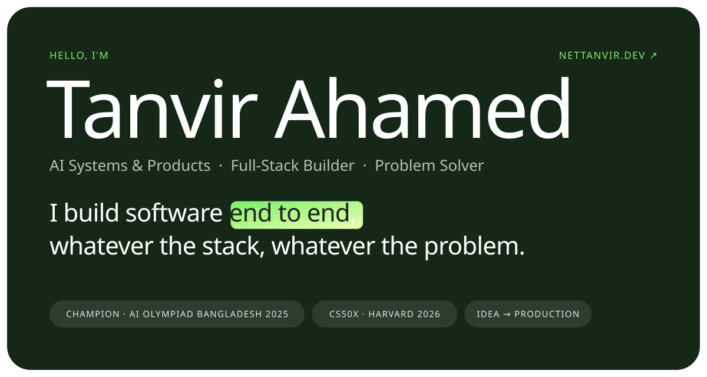</a>

<a href="https://nettanvir.dev"><picture><source media="(prefers-color-scheme: dark)" srcset="assets/btn-website-dark.svg" /></picture></a><a href="https://github.com/nettanvirdev"><picture><source media="(prefers-color-scheme: dark)" srcset="assets/btn-github-dark.svg" />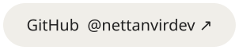</picture></a><a href="https://www.linkedin.com/in/nettanvirdev/"><picture><source media="(prefers-color-scheme: dark)" srcset="assets/btn-linkedin-dark.svg" />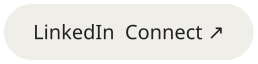</picture></a>

 

<picture><source media="(prefers-color-scheme: dark)" srcset="assets/h-about-dark.svg" />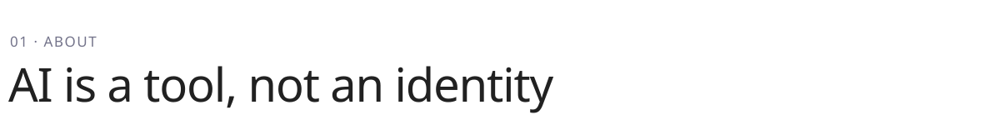</picture>

<picture><source media="(prefers-color-scheme: dark)" srcset="assets/about-dark.svg" />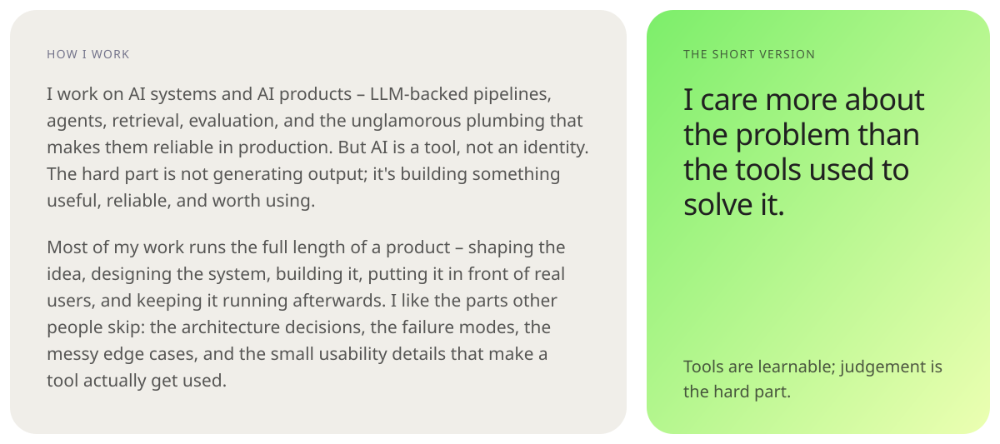</picture>

 

<picture><source media="(prefers-color-scheme: dark)" srcset="assets/h-projects-dark.svg" />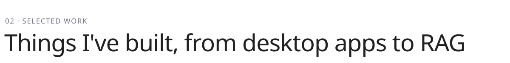</picture>

<a href="https://nettanvir.dev/inertia-ai"><picture><source media="(prefers-color-scheme: dark)" srcset="assets/p-inertia-dark.svg" />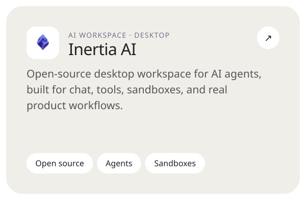</picture></a><a href="https://nettanvir.dev/maxdrive"><picture><source media="(prefers-color-scheme: dark)" srcset="assets/p-maxdrive-dark.svg" />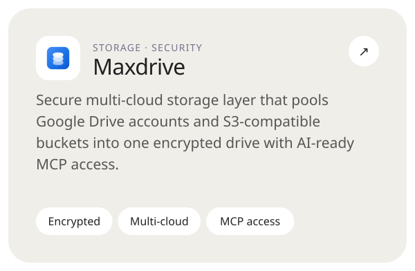</picture></a>

<a href="https://github.com/nettanvirdev/sonicnet"><picture><source media="(prefers-color-scheme: dark)" srcset="assets/p-sonicnet-dark.svg" />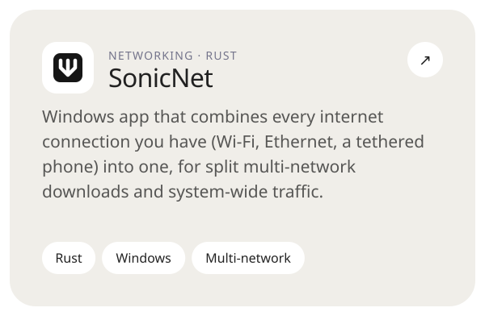</picture></a><a href="https://github.com/nettanvirdev/simple_rag"><picture><source media="(prefers-color-scheme: dark)" srcset="assets/p-simple-rag-dark.svg" />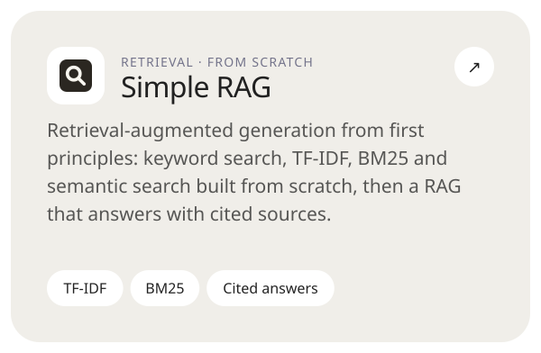</picture></a>

<a href="https://github.com/nettanvirdev/advanced_rag"><picture><source media="(prefers-color-scheme: dark)" srcset="assets/p-advanced-rag-dark.svg" />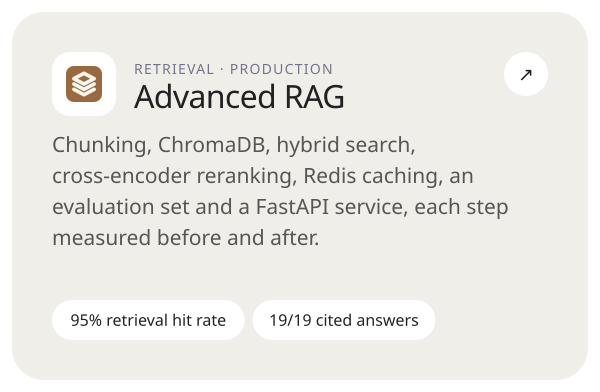</picture></a><a href="https://github.com/nettanvirdev/advanced_rag/tree/optimization"><picture><source media="(prefers-color-scheme: dark)" srcset="assets/p-optimized-rag-dark.svg" />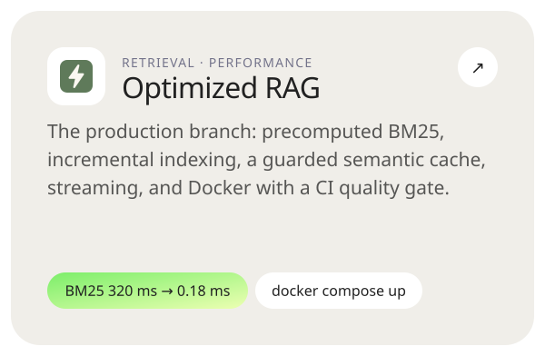</picture></a>

 

<picture><source media="(prefers-color-scheme: dark)" srcset="assets/h-what-dark.svg" />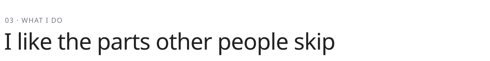</picture>

<picture><source media="(prefers-color-scheme: dark)" srcset="assets/what-dark.svg" />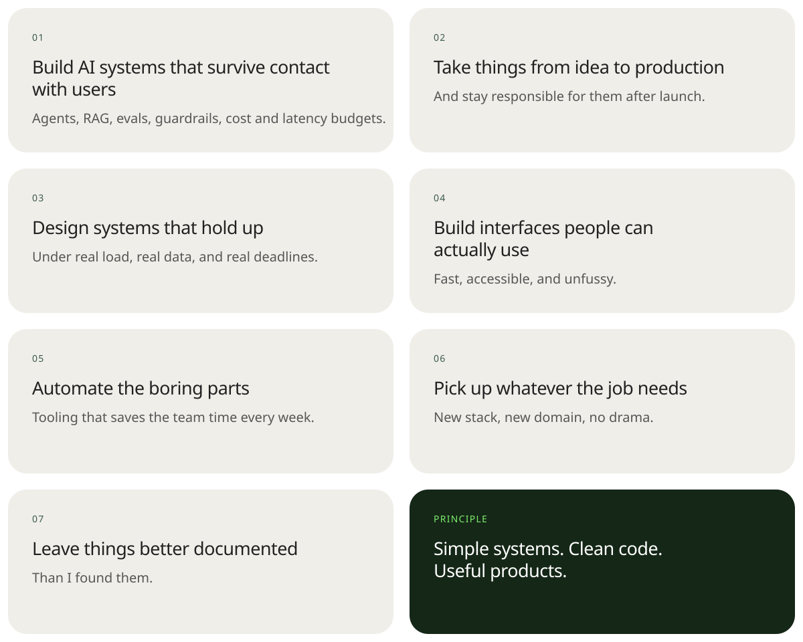</picture>

 

<picture><source media="(prefers-color-scheme: dark)" srcset="assets/h-recognition-dark.svg" />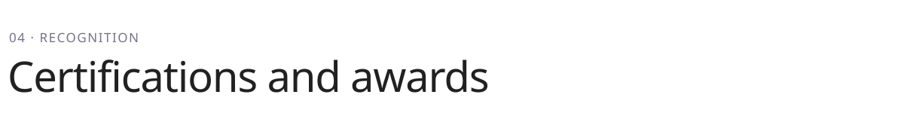</picture>

<a href="https://cs50.harvard.edu/certificates/538cc47c-0476-4e03-924c-348be404ca5a"><picture><source media="(prefers-color-scheme: dark)" srcset="assets/cert-dark.svg" />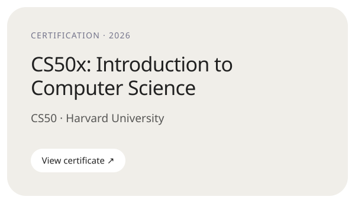</picture></a><a href="https://www.prothomalo.com/bangladesh/4ukd4oai8u">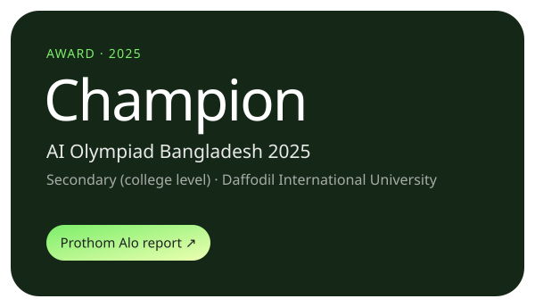</a>

 

<a href="https://www.linkedin.com/in/nettanvirdev/">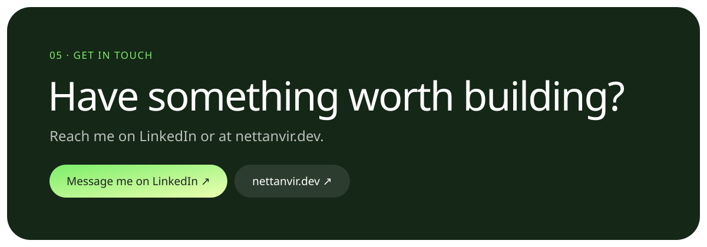</a>

<picture><source media="(prefers-color-scheme: dark)" srcset="assets/footer-dark.svg" />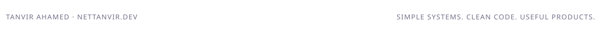</picture>

 

<picture><source media="(prefers-color-scheme: dark)" srcset="assets/live/contributions-dark.svg" /></picture>

<picture><source media="(prefers-color-scheme: dark)" srcset="assets/live/stats-dark.svg" /></picture><picture><source media="(prefers-color-scheme: dark)" srcset="assets/live/langs-dark.svg" /></picture>

<picture><source media="(prefers-color-scheme: dark)" srcset="assets/live/snake-dark.svg" /></picture>

